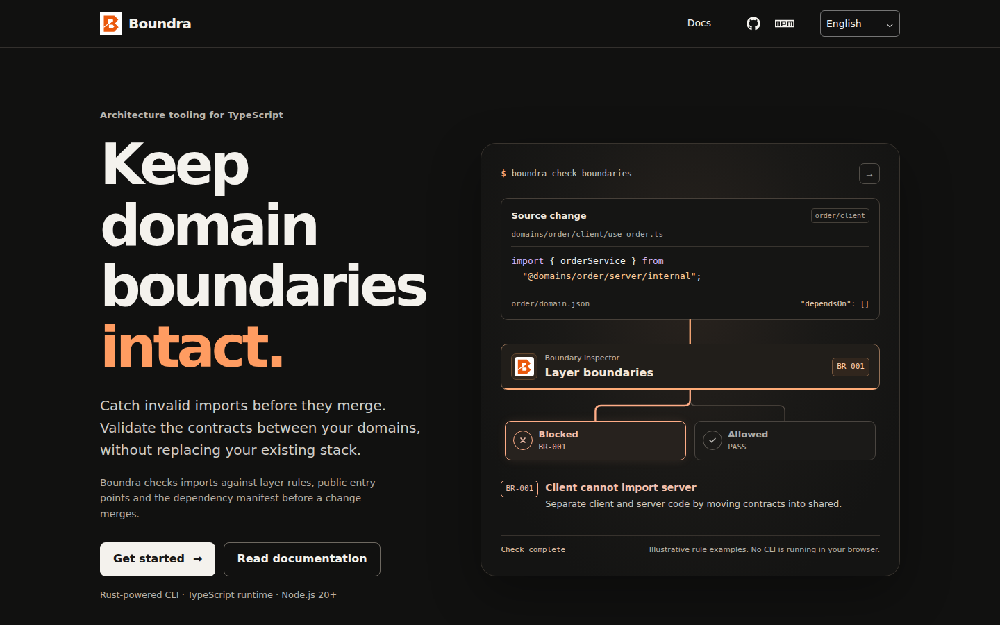

<div align="center">


# Boundra

**TypeScript のドメイン境界を守ろう。**

[English](README.md) · [한국어](README.ko.md) · [日本語](README.ja.md) · [简体中文](README.zh-CN.md)

[公式サイト](https://oddmash.github.io/boundra/ja/) · [ドキュメント](https://oddmash.github.io/boundra/docs/ja/) · [npm](https://www.npmjs.com/package/boundra) · [AI 向けドキュメント](https://oddmash.github.io/boundra/llms.txt)

[](https://www.npmjs.com/package/boundra) [](https://github.com/Oddmash/boundra/actions/workflows/boundra.yml) [](LICENSE)

</div>

Boundra は Rust 製の静的解析 CLI とスキーマベースの TypeScript 契約ランタイムを組み合わせたツールです。コードベースが成長しても、ドメイン中心のアプリケーションの import、公開インターフェース、依存関係の宣言を一貫した状態に保つことを支援します。

クライアントのファイルはサーバー実装を直接 import してはいけません。billing ドメインは order への依存関係を宣言した上で、その公開 API のみを利用します。Boundra はマージ前にこれらのルールを検証し、ランタイムは実際の呼び出しの入力と結果を検証します。既存の Next.js、Vite、バックエンド、ビルドツールをそのまま利用できます。

[](https://oddmash.github.io/boundra/ja/)

*境界チェックを説明するための可視化です。ブラウザ内でネイティブ CLI は実行されません。*

**[ユーザーガイド](docs/user-guide.ja.md)** · [導入判断と制約](docs/product-positioning.ja.md)

## クイックスタート

既存の TypeScript プロジェクトで Node.js 20 以上を使用してください。CLI は初回実行時に対応するネイティブバイナリをダウンロードして検証します。対応環境は Linux x64、macOS Intel と Apple Silicon、Windows x64 です。詳細は [インストールとオフラインでの利用](docs/cli-install.ja.md) を参照してください。

2 つのドメインを作成し、依存関係を宣言して共有契約を生成します。

```sh
pnpm add boundra zod
pnpm exec boundra init --name my-app
pnpm exec boundra create-domain order
pnpm exec boundra create-domain billing --path commerce
pnpm exec boundra add-dependency billing/order
pnpm exec boundra generate query order/get-order
pnpm exec boundra check-boundaries --format json
```

`order` と `billing` のレイヤーディレクトリとマニフェストが生成されます。billing は宣言された公開エントリーポイントを通じて order に依存できます。生成後のファイルはアプリケーションが管理するため、再生成せず既存ファイルを編集してください。依存グラフは宣言された関係を表し、すべてのランタイム呼び出しを表すものではありません。

## 検査対象

| ルール | 禁止される import または依存関係 |
| --- | --- |
| BR-001 | クライアント → サーバー |
| BR-002 | サーバー → クライアント |
| BR-003 | 共有レイヤー → ポリシーで拒否された機能 |
| BR-004 | ドメイン → 他ドメインの内部実装 |
| BR-005 | アプリ → ドメインの内部実装 |
| BR-006 | ドメイン → 未宣言の公開 API |

## 契約の定義と検証

生成される query、mutation、route 契約は入力と結果の型の基準としてスキーマを使用します。次の例を ESM TypeScript モジュールで普段使用している TypeScript ランナーを使って実行してください。バックエンドを必要とせず、ローカルトランスポートを利用します。

```ts
import { createBoundraClient, defineQuery } from "boundra";
import { z } from "zod";

const getOrder = defineQuery({
  name: "get-order",
  input: z.object({ orderId: z.string().min(1) }),
  result: z.object({
    orderId: z.string(),
    status: z.enum(["pending", "submitted"]),
  }),
});

const client = createBoundraClient(async ({ input }) => {
  const { orderId } = input as { orderId: string };
  return { orderId, status: "pending" };
});

const order = await client.query(getOrder, { orderId: "order-001" });
```

実際のリクエストには、互換性のあるホストのエンドポイントに接続した `createHttpTransport`、または独自のトランスポートアダプターを使用してください。HTTP ルーティング、認証、認可、永続化、エラー応答はホスト側の責任であり、Boundra は契約を検証します。フレームワークの置き換え、ランタイムの分離、本番環境のセキュリティ制御を提供するものではありません。

## CI に境界チェックを組み込む

既存の型チェック、テスト、ビルドとともにチェッカーを実行してください。Boundra v0.7.0 では、検査対象の最小ドメイン数を指定するオプションが追加されます。

```sh
pnpm exec boundra check-boundaries --root . --format json --min-domains 2
```

プロジェクトで想定するドメイン数に合わせてしきい値を調整してください。JSON レポートには診断と検査範囲が含まれます。`graph-domains --format mermaid` で宣言された依存関係を確認できます。任意の `boundra/vite` プラグインは開発時の診断を表示し、本番ビルドには挿入されません。

## ドキュメント

- [クイックスタート](docs/quickstart.ja.md)
- [アーキテクチャ](docs/architecture.ja.md)
- [境界ルール](docs/boundary-rules.ja.md)
- [CLI のインストール](docs/cli-install.ja.md)
- [CLI リファレンス](docs/cli-spec-v1.ja.md)
- [設定](docs/config-spec.ja.md)
- [契約スキーマ](docs/contract-schema-spec.ja.md)
- [HTTP トランスポート](docs/http-transport.ja.md)
- [注文と請求のドメイン例](examples/order-billing)
- [Vite 統合](docs/vite-integration.ja.md)
- [パフォーマンス](docs/performance.ja.md)
- [ドキュメント索引（英語）](docs/readme.md)
- [コントリビューション（英語）](CONTRIBUTING.md)

Boundra は公開プレビュー段階です。導入評価中も既存の検証手順を維持してください。v0.7.0 の[リリースノート](docs/releases/v0-7-0.md)と[変更履歴](CHANGELOG.md)は英語で提供されています。
