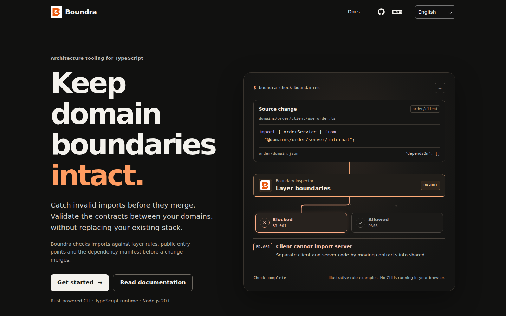

<div align="center">


# Boundra

**TypeScript의 도메인 경계를 지켜내세요.**

[English](README.md) · [한국어](README.ko.md) · [日本語](README.ja.md) · [简体中文](README.zh-CN.md)

[공식 웹사이트](https://oddmash.github.io/boundra/ko/) · [문서](https://oddmash.github.io/boundra/docs/ko/) · [npm](https://www.npmjs.com/package/boundra) · [AI용 문서](https://oddmash.github.io/boundra/llms.txt)

[](https://www.npmjs.com/package/boundra) [](https://github.com/Oddmash/boundra/actions/workflows/boundra.yml) [](LICENSE)

</div>

Boundra는 Rust 기반 정적 분석 CLI와 스키마 기반 TypeScript 계약 런타임을 결합합니다. 코드베이스가 성장하더라도 도메인 중심 애플리케이션의 import, 공개 인터페이스 및 의존성 선언을 일관되게 유지하도록 돕습니다.

클라이언트 파일은 서버 구현을 직접 import해서는 안 됩니다. billing 도메인은 order에 대한 의존성을 명시한 뒤 공개 API만 사용해야 합니다. Boundra는 병합 전에 이러한 규칙을 검사하고, 런타임은 실제 호출의 입력과 결과를 검증합니다. 기존 Next.js, Vite, 백엔드와 빌드 도구는 그대로 유지할 수 있습니다.

[](https://oddmash.github.io/boundra/ko/)

*경계 검사 규칙을 설명하는 시각화입니다. 브라우저에서 네이티브 CLI를 실행하지 않습니다.*

**[상세 사용 가이드](docs/user-guide.ko.md)** · [도입 기준 및 장단점](docs/product-positioning.ko.md)

## 빠른 시작

기존 TypeScript 프로젝트에서 Node.js 20 이상을 사용하세요. CLI는 처음 실행할 때 대응하는 네이티브 바이너리를 다운로드하고 검증합니다. 지원 대상은 Linux x64, macOS Intel 및 Apple Silicon, Windows x64입니다. 자세한 내용은 [설치 및 오프라인 사용](docs/cli-install.ko.md) 문서를 참고하세요.

두 도메인을 생성하고 의존성을 선언한 뒤 공유 계약을 생성합니다.

```sh
pnpm add boundra zod
pnpm exec boundra init --name my-app
pnpm exec boundra create-domain order
pnpm exec boundra create-domain billing --path commerce
pnpm exec boundra add-dependency billing/order
pnpm exec boundra generate query order/get-order
pnpm exec boundra check-boundaries --format json
```

`order`와 `billing`의 계층 디렉터리 및 매니페스트가 생성됩니다. Billing은 선언된 공개 진입점을 통해 order에 의존할 수 있습니다. 생성된 파일은 애플리케이션이 직접 관리하므로 다시 생성하는 대신 기존 파일을 수정하세요. 의존성 그래프는 선언된 관계를 나타내며 모든 런타임 호출을 뜻하지 않습니다.

## 검사 규칙

| 규칙 | 금지된 import 또는 의존성 |
| --- | --- |
| BR-001 | 클라이언트 → 서버 |
| BR-002 | 서버 → 클라이언트 |
| BR-003 | 공유 계층 → 정책상 거부된 기능 |
| BR-004 | 도메인 → 다른 도메인의 내부 구현 |
| BR-005 | 앱 → 도메인의 내부 구현 |
| BR-006 | 도메인 → 미선언 공개 API |

## 계약 정의 및 검증

생성되는 query, mutation, route 계약은 입력과 결과 타입의 기준으로 스키마를 사용합니다. ESM TypeScript 모듈에서 평소 사용하는 TypeScript 실행기로 다음 예제를 실행하세요. 백엔드 없이 로컬 전송 계층을 사용합니다.

```ts
import { createBoundraClient, defineQuery } from "boundra";
import { z } from "zod";

const getOrder = defineQuery({
  name: "get-order",
  input: z.object({ orderId: z.string().min(1) }),
  result: z.object({
    orderId: z.string(),
    status: z.enum(["pending", "submitted"]),
  }),
});

const client = createBoundraClient(async ({ input }) => {
  const { orderId } = input as { orderId: string };
  return { orderId, status: "pending" };
});

const order = await client.query(getOrder, { orderId: "order-001" });
```

실제 요청에서는 호환되는 호스트 엔드포인트를 연결한 `createHttpTransport` 또는 자체 전송 어댑터를 사용하세요. HTTP 라우팅, 인증, 인가, 영속성 및 오류 응답은 호스트에서 관리하고 Boundra는 계약을 검증합니다. 프레임워크를 대체하거나 런타임 격리 및 프로덕션 보안 제어 기능을 제공하지 않습니다.

## CI에서 경계 검사

기존 타입 검사, 테스트 및 빌드와 함께 검사기를 실행하세요. Boundra v0.7.0에는 선택적으로 최소 도메인 스캔 범위를 요구하는 기능이 추가됩니다.

```sh
pnpm exec boundra check-boundaries --root . --format json --min-domains 2
```

프로젝트 예상 도메인 수에 맞게 임계값을 조정하세요. JSON 보고서에는 진단과 스캔 범위가 포함됩니다. `graph-domains --format mermaid`로 선언된 의존성을 검토할 수 있습니다. 선택적 Vite 플러그인 `boundra/vite`는 개발 진단을 표시하며 프로덕션 빌드에는 삽입되지 않습니다.

## 문서 더 보기

- [빠른 시작](docs/quickstart.ko.md)
- [아키텍처](docs/architecture.ko.md)
- [경계 규칙](docs/boundary-rules.ko.md)
- [CLI 설치](docs/cli-install.ko.md)
- [CLI 명세](docs/cli-spec-v1.ko.md)
- [설정](docs/config-spec.ko.md)
- [계약 스키마](docs/contract-schema-spec.ko.md)
- [HTTP 전송 계층](docs/http-transport.ko.md)
- [주문 및 청구 도메인 예제](examples/order-billing)
- [Vite 통합](docs/vite-integration.ko.md)
- [성능](docs/performance.ko.md)
- [문서 인덱스 (영어)](docs/readme.md)
- [기여 방법 (영어)](CONTRIBUTING.md)

Boundra는 공개 프리뷰 단계입니다. 도입을 평가하는 동안 기존 검증 흐름을 유지하세요. v0.7.0의 [릴리스 노트](docs/releases/v0-7-0.md) 및 [변경 이력](CHANGELOG.md)은 영어로 제공됩니다.
