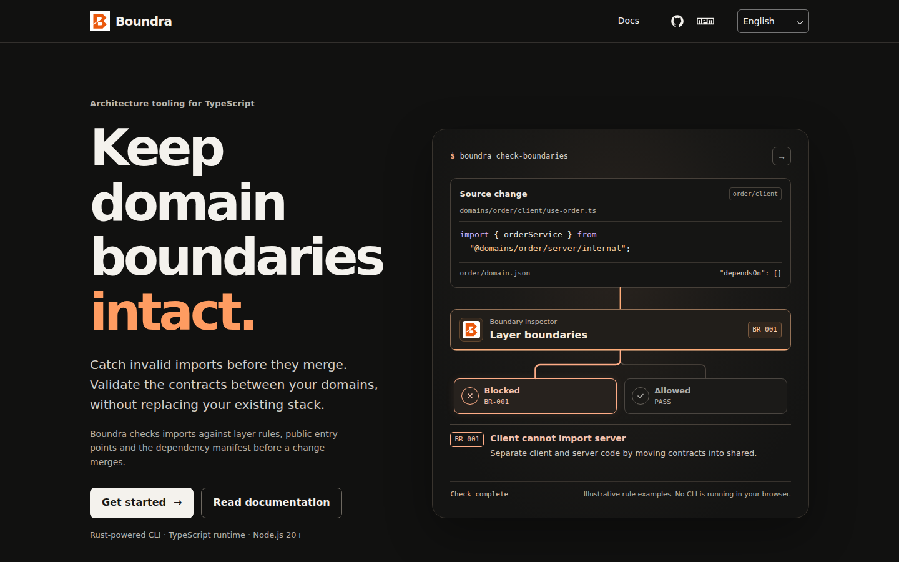

<div align="center">


# Boundra

**守住 TypeScript 的领域边界。**

[English](README.md) · [한국어](README.ko.md) · [日本語](README.ja.md) · [简体中文](README.zh-CN.md)

[官方网站](https://oddmash.github.io/boundra/zh-cn/) · [文档](https://oddmash.github.io/boundra/docs/zh-cn/) · [npm](https://www.npmjs.com/package/boundra) · [AI 可读文档](https://oddmash.github.io/boundra/llms.txt)

[](https://www.npmjs.com/package/boundra) [](https://github.com/Oddmash/boundra/actions/workflows/boundra.yml) [](LICENSE)

</div>

Boundra 将 Rust 编写的静态分析 CLI 与基于模式的 TypeScript 契约运行时相结合，帮助领域优先的应用在代码库不断增长时保持 import、公开接口和依赖声明的一致性。

客户端文件不应直接 import 服务端实现。billing 领域只有声明对 order 的依赖后，才能使用其公开 API。Boundra 在合并前检查这些规则，运行时则在实际调用时验证契约的输入和结果。可以继续使用现有 Next.js、Vite、后端和构建工具。

[](https://oddmash.github.io/boundra/zh-cn/)

*用于说明边界检查规则的可视化演示。浏览器不会执行原生 CLI。*

**[详细使用指南](docs/user-guide.zh-cn.md)** · [采用建议及取舍](docs/product-positioning.zh-cn.md)

## 快速开始

在现有 TypeScript 项目中使用 Node.js 20 或更高版本。CLI 首次运行时下载并验证对应的原生二进制文件。支持 Linux x64、macOS Intel 和 Apple Silicon、Windows x64。详情请参阅 [安装和离线使用](docs/cli-install.zh-cn.md)。

创建两个领域、声明其依赖关系并生成共享契约：

```sh
pnpm add boundra zod
pnpm exec boundra init --name my-app
pnpm exec boundra create-domain order
pnpm exec boundra create-domain billing --path commerce
pnpm exec boundra add-dependency billing/order
pnpm exec boundra generate query order/get-order
pnpm exec boundra check-boundaries --format json
```

这将创建 `order` 和 `billing` 的分层目录及清单。billing 可以通过已声明的公开入口依赖 order。生成的文件由应用自行管理，因此应直接修改而非重新生成。依赖图描述已声明的关系，并不表示所有运行时调用。

## 检查规则

| 规则 | 禁止的 import 或依赖 |
| --- | --- |
| BR-001 | 客户端 → 服务端 |
| BR-002 | 服务端 → 客户端 |
| BR-003 | 共享层 → 策略禁止的能力 |
| BR-004 | 领域 → 其他领域内部实现 |
| BR-005 | 应用 → 领域内部实现 |
| BR-006 | 领域 → 未声明的公开 API |

## 定义与验证契约

生成的 query、mutation 和 route 契约以模式作为输入和结果类型的依据。请使用日常的 TypeScript 运行工具在 ESM TypeScript 模块中运行以下示例。它使用本地传输层，无需后端：

```ts
import { createBoundraClient, defineQuery } from "boundra";
import { z } from "zod";

const getOrder = defineQuery({
  name: "get-order",
  input: z.object({ orderId: z.string().min(1) }),
  result: z.object({
    orderId: z.string(),
    status: z.enum(["pending", "submitted"]),
  }),
});

const client = createBoundraClient(async ({ input }) => {
  const { orderId } = input as { orderId: string };
  return { orderId, status: "pending" };
});

const order = await client.query(getOrder, { orderId: "order-001" });
```

实际请求可使用连接到兼容宿主端点的 `createHttpTransport` 或自定义传输适配器。HTTP 路由、身份认证、授权、持久化和错误响应由宿主负责，Boundra 验证契约。它不会替代框架，也不提供运行时隔离或生产环境安全控制。

## 将边界检查纳入 CI

将检查器与现有类型检查、测试及构建一起运行。Boundra v0.7.0 新增可选的最小领域扫描覆盖要求：

```sh
pnpm exec boundra check-boundaries --root . --format json --min-domains 2
```

依据项目预期的领域数调整阈值。JSON 报告包含诊断信息和扫描覆盖范围。`graph-domains --format mermaid` 有助于审查已声明的依赖关系。可选的 `boundra/vite` 插件显示开发诊断，不会注入生产构建。

## 查阅文档

- [快速开始](docs/quickstart.zh-cn.md)
- [架构](docs/architecture.zh-cn.md)
- [边界规则](docs/boundary-rules.zh-cn.md)
- [CLI 安装](docs/cli-install.zh-cn.md)
- [CLI 参考](docs/cli-spec-v1.zh-cn.md)
- [配置](docs/config-spec.zh-cn.md)
- [契约模式](docs/contract-schema-spec.zh-cn.md)
- [HTTP 传输层](docs/http-transport.zh-cn.md)
- [订单与账单领域示例](examples/order-billing)
- [Vite 集成](docs/vite-integration.zh-cn.md)
- [性能](docs/performance.zh-cn.md)
- [文档索引（英语）](docs/readme.md)
- [贡献指南（英语）](CONTRIBUTING.md)

Boundra 处于公开预览阶段。在评估采用方案时，请保留现有验证流程。v0.7.0 的[版本说明](docs/releases/v0-7-0.md)与[变更记录](CHANGELOG.md)使用英语提供。
